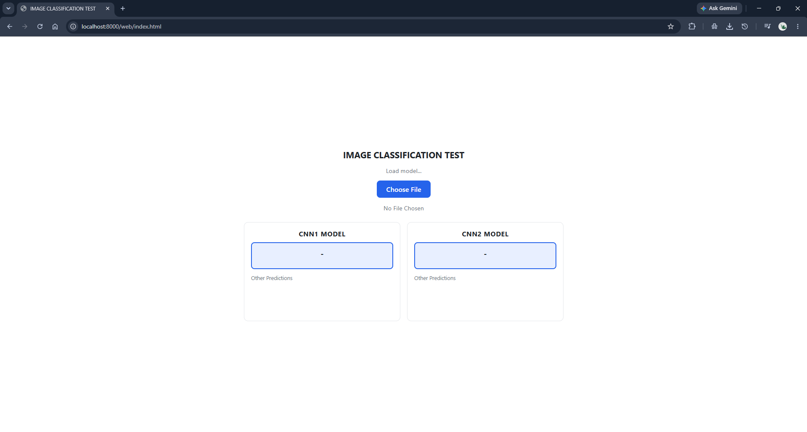
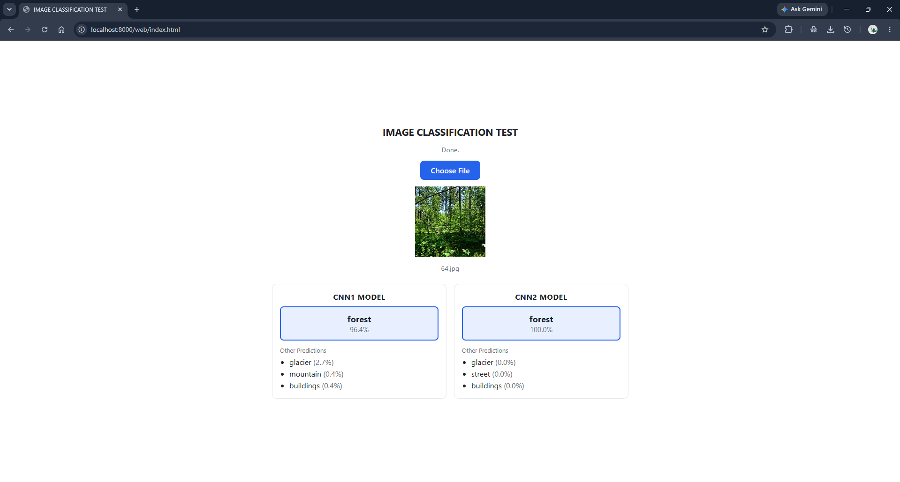

# KLASIFIKASI GAMBAR  (TF-KERAS)

Proyek submission klasifikasi gambar menggunakan Convolutional Neural Network (CNN) dengan dua model (`cnn1_model` dan `cnn2_model`) dilatih di Google Colab. Lalu, konversi model dilakukan dalam dua lingkungan dan media berbeda.

## Struktur Folder

```
submission/
├── exported_model/
│   ├── cnn1/
│   │   ├── saved_model/         # SavedModel (saved_model.pb, variables, assets)
│   │   ├── tflite/              # model.tflite dan label.txt
│   │   └── tfjs_model_graph/    # model.json dan berkas group1-shard*.bin
│   └── cnn2/                    # struktur sama dengan cnn1
│       └── ...
├── web
│   └── index.html
├── img_classification_CNN_colabv1.ipynb
├── img_classification_cnn_colabv1.py
├── requirements.txt
└── tfjs.txt
```

## Model

| Model | Arsitektur | Akurasi train | Akurasi val | Akurasi test |
|---|---|---|---|---|
| `cnn1` | CNN sederhana dengan `tf.keras` (Sequential, tanpa bobot pretrained): Rescaling (1/255), 3 blok Conv2D 3x3 + MaxPooling (32, 64, 128 filter, ReLU), Flatten, Dense 64 (ReLU), Dense 6 (softmax) | **82,13%** | **81,00%** | **81,70%** |
| `cnn2` | Transfer learning: Rescaling (1/127.5, offset -1), MobileNetV2 berbobot ImageNet, Conv2D 256 (3x3, ReLU), MaxPooling, Global Average Pooling, Dropout 0.4, Dense 6 (softmax) | **93,4%** | **91,7%** | **91,57%** |

## Proses Pelatihan, Pengujian, Eksport Model

### 1️⃣ Pelatihan dan Ekspor (Google Colab)

Pelatihan dilakukan mwelalui `img_classification_CNN_colabv1.ipynb` di Google Colab. Tipe runtime selama proses pelatihan dan ekspor menggunakan T4 GPU untuk efisiensi komputasi model. Lalu, model dieksport ke SavedModel dan TFLite.

| Model | Tahap | Optimizer | Epoch maksimum | Catatan |
|---|---|---|---|---|
| `cnn1` | Pelatihan penuh | Adam (bawaan) | 20 | `EarlyStopping` patience 3 |
| `cnn2` | 1. Ekstraksi fitur | Adam 1e-3 | 25 | MobileNetV2 dibekukan, `EarlyStopping` patience 4 |
| `cnn2` | 2. Fine-tuning | Adam 1e-5 | 20 epoch tambahan | 40 layer terakhir MobileNetV2 dilatih (layer BatchNorm tetap beku), `EarlyStopping` patience 5 dan `ReduceLROnPlateau` (faktor 0.3, patience 2) |

Sintaksis eksport model:

```python
# 1. SavedModel
for nama, model in models.items():
    model.export(f"{base}/{nama}/saved_model")
    print(nama, "-> saved_model selesai")

# 2. TFLite (dari SavedModel)
for nama in models:
    converter = tf.lite.TFLiteConverter.from_saved_model(f"{base}/{nama}/saved_model")
    with open(f"{base}/{nama}/tflite/model.tflite", "wb") as f:
        f.write(converter.convert())
        print(nama, "-> tflite selesai")
```


### 2️⃣ Konversi ke TensorFlow.js (lokal, Windows)

Konversi TFJS dikerjakan di lokal karena pustaka `tensorflowjs` tidak cocok dengan versi paket di Colab (TensorFlow 2.21, Keras 3, NumPy 2). Lebih lanjut lihat [requirements.txt](./requirements.txt). Maka dari itu, dilakukan di lokal lewat VSCode dengan membuat virtual environment. Hal ini untuk menghindari konflik dengan tipe tensorflow dan versi Python yang sudah terpasang pada lingkungan Python yang ada.

#### 🟠 1. Siapkan environment

1.1. Buka terminal command prompt (cmd)


```bash
conda create -n tfjs python=3.10
```

1.2. Aktifkan virtual environment `tfjs`
```bash
conda activate tfjs
```

1.3. Upgrade pip
``` bash
python -m pip install --upgrade pip
```

1.4. Install beberapa dependsi. Lebih lanjut lihat [tfjs.txt](./tfjs.txt)
``` bash
pip install tensorflow==2.15.0 tf-keras==2.15.0 tensorflow-hub==0.16.1 "numpy<2" "protobuf<5" "setuptools<70" h5py six packaging importlib_resources
pip install --no-deps tensorflowjs tensorflow_decision_forests ydf
```

Instalasi dengan `--no-deps` terhadap tensorflowjs berhasil memasang tensorflowjs versi 4.22.0.

#### 🟠 2. Catatan khusus Windows

Pada `tensorflowjs` 4.22.0, `tensorflowjs_converter` mengimpor `tensorflow_decision_forests` dan `jax` saat dijalankan, padahal keduanya tidak dibutuhkan untuk model CNN. Di Windows, `tensorflow_decision_forests` tidak memiliki pustaka `inference.so`, sehingga konverter gagal diimpor. Solusi yang dipakai adalah memberi tanda komentar pada dua baris impor di paket `tensorflowjs` yang terpasang (folder `site-packages/tensorflowjs/converters/` pada environment `tfjs`):

- `tf_saved_model_conversion_v2.py`: baris `import tensorflow_decision_forests`
- `__init__.py`: baris `from tensorflowjs.converters.jax_conversion import convert_jax`

Perubahan ini hilang jika `tensorflowjs` dipasang ulang atau diperbarui. Alternatif tanpa modifikasi adalah menjalankan konversi di WSL2 (Ubuntu).

#### 🟠 3. Jalankan konversi

Buat code cell baru di `img_classification_CNN_colabv1`. Salin dan tempel sintaksis di bawah ini, lalu jalankan cell. Pastikan environment `tfjs` aktif sebelum menjalankan kode.

Referensi: https://www.tensorflow.org/js/tutorials/conversion/import_saved_model

```bash
!tensorflowjs_converter \
    --input_format=tf_saved_model \
    --output_format=tfjs_graph_model \
    --saved_model_tags=serve \
    exported_model/cnn1/saved_model \
    exported_model/cnn1/tfjs_model_graph

!tensorflowjs_converter \
    --input_format=tf_saved_model \
    --output_format=tfjs_graph_model \
    --saved_model_tags=serve \
    exported_model/cnn2/saved_model \
    exported_model/cnn2/tfjs_model_graph
```


## Menjalankan Model di Browser

### Memakai halaman uji (`web/index.html`)

1. Buka terminal, lalu jalankan server:

```bash
python -m http.server 8000
```
2. Buka `http://localhost:8000/web/index.html` di browser.



3. Pilih satu gambar.



4. Halaman menampilkan hasil dari `cnn1` dan `cnn2` secara berdampingan.

Catatan: Koneksi internet dibutuhkan saat halaman pertama dimuat untuk mengunduh Tensorflow.js dari CDN.


## Environment

Google Colab: [requirements.txt](./requirements.txt) <br>
Lokal, Windows: [tfjs.txt](./tfjs.txt)
