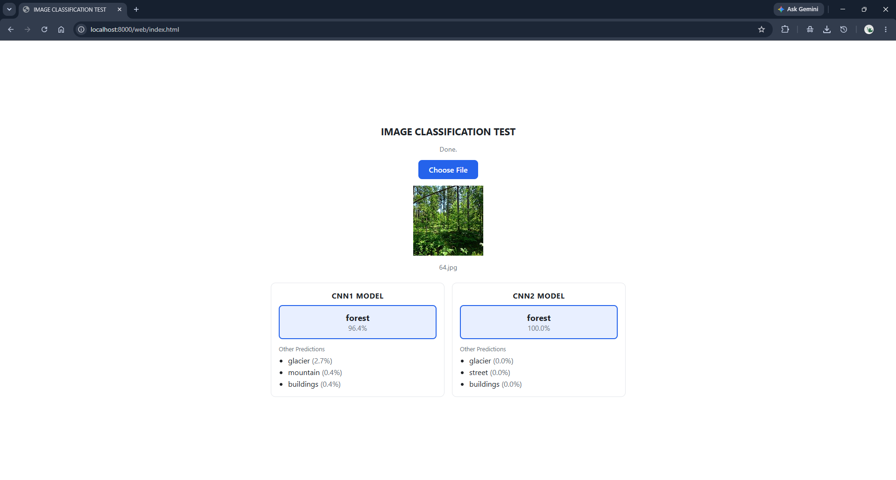
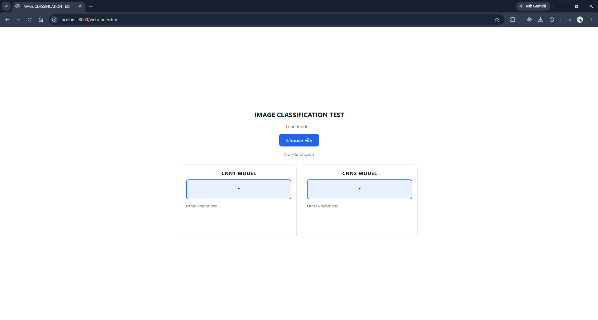

# Klasifikasi Gambar dengan CNN (TF-Keras)


Proyek submission **klasifikasi gambar (6 kelas)** menggunakan *Convolutional Neural Network* (CNN). Dua model dibandingkan: `cnn1` (CNN sederhana dari nol) dan `cnn2` (*transfer learning* MobileNetV2). Keduanya dilatih di **Google Colab**, diekspor ke **SavedModel** dan **TFLite**, lalu dikonversi ke **TensorFlow.js** di lingkungan lokal (Windows) agar dapat dijalankan langsung di browser.

**Tujuan:**
1. Membangun dan melatih model klasifikasi gambar 6 kelas dengan `tf.keras`.
2. Membandingkan performa CNN sederhana dengan *transfer learning* MobileNetV2.
3. Mengekspor model ke SavedModel, TFLite, dan TensorFlow.js.
4. Menguji kedua model secara langsung di browser melalui halaman web sederhana.

## 🗂️ STRUKTUR REPO

```
submission/
├── exported_model/
│   ├── cnn1/
│   │   ├── saved_model/         # SavedModel (saved_model.pb, variables, assets)
│   │   ├── tflite/              # model.tflite dan label.txt
│   │   └── tfjs_model_graph/    # model.json dan berkas group1-shard*.bin
│   └── cnn2/                    # struktur sama dengan cnn1
├── lampiran/                    # Tangkapan layar halaman uji
├── web/
│   └── index.html               # Halaman uji di browser
├── README.md
├── img_classification_CNN_colabv1.ipynb
├── img_classification_cnn_colabv1.py
├── requirements.txt             # Environment Google Colab
└── tfjs.txt                     # Environment lokal (konversi TFJS)
```

## 🧠 MODEL

| Model | Arsitektur | Akurasi train | Akurasi val | Akurasi test |
|---|---|---|---|---|
| `cnn1` | CNN sederhana dengan `tf.keras` (Sequential, tanpa bobot pretrained): <br>Rescaling (1/255) → 3 blok Conv2D 3x3 + MaxPooling (32, 64, 128 filter, ReLU) → Flatten → Dense 64 (ReLU) → Dense 6 (softmax) | **82,13%** | **81,00%** | **81,70%** |
| `cnn2` | Transfer learning: <br>Rescaling (1/127.5, offset -1) → MobileNetV2 (bobot ImageNet) → Conv2D 256 (3x3, ReLU) → MaxPooling → Global Average Pooling → Dropout 0.4 → Dense 6 (softmax) | **93,4%** | **91,7%** | **91,57%** |

**Model terbaik: `cnn2` (MobileNetV2 + fine-tuning)** dengan akurasi test 91,57%.

## 🔄 ALUR KERJA

| Environment | Kegunaan | Berkas |
|---|---|---|
| Google Colab | Pelatihan, ekspor SavedModel dan TFLite | [requirements.txt](./requirements.txt) |
| Lokal, Windows | Konversi ke TensorFlow.js | [tfjs.txt](./tfjs.txt) |

1. Jalankan `img_classification_CNN_colabv1.ipynb` di Google Colab (runtime T4 GPU) → menghasilkan SavedModel dan TFLite.
    - Ekspor Savedodel dengan `model.export()`.
    - Konversi TFLite dari SavedModel dengan `tf.lite.TFLiteConverter`.
2. Unduh folder `exported_model/` ke komputer lokal.
3. [Konversi ke TFJS](#-konversi-ke-tensorflowjs-lokal-windows) dengan dari SavedModel di lingkungan lokal Windows (*virtual environment* Conda terpisah).
4. Jalankan [halaman uji di browser](#-menjalankan-model-di-browser).

## Pelatihan dan Ekspor (Google Colab)

Pelatihan dilakukan melalui `img_classification_CNN_colabv1.ipynb`. Setelah selesai, model diekspor ke format SavedModel dan TFLite.

| Model | Tahap | Optimizer | Epoch Maksimum | Catatan |
|---|---|---|---|---|
| `cnn1` | Pelatihan penuh | Adam (bawaan) | 20 | `EarlyStopping` (patience 3) |
| `cnn2` | 1. Ekstraksi fitur | Adam 1e-3 | 25 | MobileNetV2 dibekukan, `EarlyStopping` (patience 4) |
| `cnn2` | 2. Fine-tuning | Adam 1e-5 | 20 (tambahan) | 40 layer terakhir MobileNetV2 dilatih (layer BatchNorm tetap beku), `EarlyStopping` (patience 5) dan `ReduceLROnPlateau` (faktor 0.3, patience 2) |

**Kode ekspor model:**

```python
# 1. SavedModel
for nama, model in models.items():
    model.export(f"{base}/{nama}/saved_model")
    print(nama, "-> saved_model selesai")

# 2. TFLite (dari SavedModel)
for nama in models:
    converter = tf.lite.TFLiteConverter.from_saved_model(f"{base}/{nama}/saved_model")
    with open(f"{base}/{nama}/tflite/model.tflite", "wb") as f:
        f.write(converter.convert())
    print(nama, "-> tflite selesai")
```

> 📌 Folder `tflite/` harus sudah ada sebelum kode di atas dijalankan (misalnya dengan `os.makedirs(..., exist_ok=True)`).

## Konversi ke TensorFlow.js (Lokal, Windows)

Konversi TFJS dilakukan secara lokal karena pustaka `tensorflowjs` tidak kompatibel dengan versi paket di Colab (TensorFlow 2.21, Keras 3, NumPy 2). Detail versi ada di [requirements.txt](./requirements.txt) dan [tfjs.txt](./tfjs.txt). Agar tidak bentrok dengan TensorFlow dan Python yang sudah terpasang, konversi dijalankan di *virtual environment* Conda terpisah.

### 1. Siapkan environment

1. Buka terminal command prompt (cmd) di VSCode

    ```bash
    conda create -n tfjs python=3.10
    ```

2. Aktifkan virtual environment `tfjs`
    ```bash
    conda activate tfjs
    ```

3. Upgrade pip
    ``` bash
    python -m pip install --upgrade pip
    ```

4. Install beberapa dependsi. Lebih lanjut lihat [tfjs.txt](./tfjs.txt)
    ``` bash
    pip install tensorflow==2.15.0 tf-keras==2.15.0 tensorflow-hub==0.16.1 "numpy<2" "protobuf<5" "setuptools<70" h5py six packaging importlib_resources
    pip install --no-deps tensorflowjs tensorflow_decision_forests ydf
    ```

Instalasi `tensorflowjs` dengan `--no-deps` memasang versi **4.22.0**.

### 2. Catatan khusus Windows

`tensorflowjs_converter` 4.22.0 mengimpor `tensorflow_decision_forests` dan `jax` saat dijalankan, padahal keduanya tidak dibutuhkan untuk model CNN. Di Windows, `tensorflow_decision_forests` tidak memiliki pustaka `inference.so`, sehingga konverter gagal diimpor.

**Solusi:** beri tanda komentar (`#`) pada dua baris impor di folder `site-packages/tensorflowjs/converters/` pada environment `tfjs`:

- `tf_saved_model_conversion_v2.py`: baris `import tensorflow_decision_forests`
- `__init__.py`: baris `from tensorflowjs.converters.jax_conversion import convert_jax`

> ⚠️ Perubahan ini hilang jika `tensorflowjs` dipasang ulang atau diperbarui. Alternatif tanpa modifikasi adalah menjalankan konversi di **WSL2 (Ubuntu)**.

### 3. Jalankan konversi

Pastikan environment `tfjs` aktif, lalu jalankan perintah berikut **di terminal dari folder `submission/`**:

```bash
tensorflowjs_converter --input_format=tf_saved_model --output_format=tfjs_graph_model --saved_model_tags=serve exported_model/cnn1/saved_model exported_model/cnn1/tfjs_model_graph

tensorflowjs_converter --input_format=tf_saved_model --output_format=tfjs_graph_model --saved_model_tags=serve exported_model/cnn2/saved_model exported_model/cnn2/tfjs_model_graph
```

atau jalankan di code cell akhir notebook.

Referensi: [Import SavedModel ke TensorFlow.js](https://www.tensorflow.org/js/tutorials/conversion/import_saved_model)

## 🖥️ MENJALANKAN MODEL DI BROWSER

Gunakan halaman uji `web/index.html`:

1. Buka terminal di folder `submission/`, lalu jalankan server lokal:

   ```bash
   python -m http.server 8000
   ```

2. Buka `http://localhost:8000/web/index.html` di browser.

   

3. Pilih satu gambar.

4. Halaman menampilkan hasil prediksi `cnn1` dan `cnn2` secara berdampingan.

   

> 📌 Koneksi internet diperlukan saat halaman pertama kali dimuat untuk mengunduh TensorFlow.js dari CDN.

## 💡 TEMUAN UTAMA

1. **Transfer learning jauh lebih unggul.** `cnn2` mengungguli `cnn1` sekitar **9,9 poin persentase** pada data uji (91,57% vs 81,70%).
2. **Kedua model tidak menunjukkan overfitting berarti.** Selisih akurasi train dan val hanya sekitar 1,1 poin (`cnn1`) dan 1,7 poin (`cnn2`), dan akurasi test sejalan dengan akurasi val.
3. **Fine-tuning dua tahap efektif.** Ekstraksi fitur dengan MobileNetV2 beku, dilanjutkan fine-tuning 40 layer terakhir dengan *learning rate* kecil (1e-5), menghasilkan model yang stabil.
4. **Ketiga format ekspor tersedia.** SavedModel, TFLite, dan TFJS siap dipakai untuk server, mobile, dan web.

## ⚠️ KETERBATASAN

- Konversi TFJS di Windows bergantung pada **modifikasi manual** paket `tensorflowjs` yang hilang saat dipasang ulang.
- Halaman uji membutuhkan **koneksi internet** untuk memuat TensorFlow.js dari CDN.
- Evaluasi hanya memakai akurasi; metrik per kelas (precision, recall, F1) dan *confusion matrix* belum dilaporkan.
- Halaman uji dijalankan lewat server lokal sederhana (`http.server`), bukan untuk penggunaan produksi.